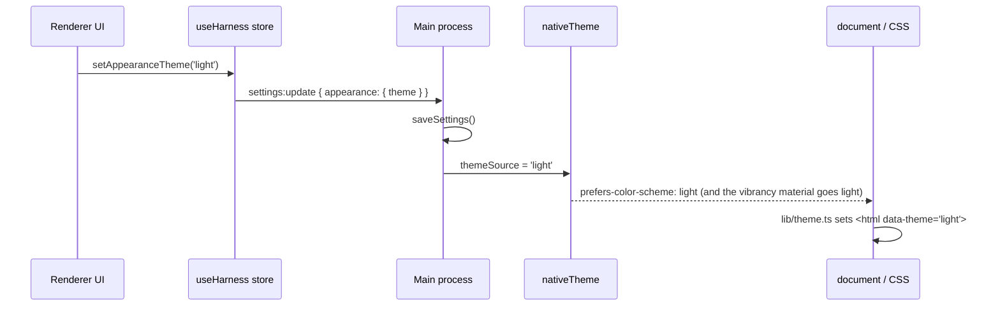

# Appearance: dark and light shells

Freyja has two shells. Dark is the original frosted-charcoal glass. Light is the same glass in white. `System` follows the macOS appearance, including its sunset schedule. This document describes how the switch works and where the colour system lives.

## What the operator sees

**Settings → appearance** (⌘,) shows three swatches: System, Dark, Light. Each swatch is a miniature of the window in that theme, so the choice is visible before it is made. The System swatch shows both halves and says which one macOS is asking for right now.

**⌘⇧L** flips between dark and light from anywhere. The sun or moon button in the sidebar footer, next to `settings`, does the same. The command palette (⌘K) has `Appearance: switch to … mode` and `Appearance: follow system`. A flip pins the opposite of what is on screen; Settings is where `system` comes back.

The choice is saved in `~/.freyja/settings.json` under `appearance.theme` and survives restarts.

## How the switch works

The main process owns the native side. `applyAppearance()` in `src/main/main.ts` mirrors the saved preference into `nativeTheme.themeSource` at window creation and after every settings write. That one assignment drives both the macOS vibrancy material behind the window and `prefers-color-scheme` inside it.

The renderer owns the painted side. `src/renderer/lib/theme.ts` reads `prefers-color-scheme` before the first React render (`initTheme()` in `main.tsx`) and writes the result to `<html data-theme>` and the CSS `color-scheme`. It listens for changes from then on. Because the media query inside Electron is a mirror of `themeSource`, the frost and the stylesheet can never disagree.

In a plain browser (design review, no preload) there is no main process. The preference then lives in `localStorage` under `freyja.appearance.theme` and is applied directly on top of the media query.

Canvas and WebGL painters cannot read CSS variables at draw time. They subscribe through `useEffectiveTheme()` (a tiny zustand store written by the same code path) and read concrete values with `cssTokenRgb()`. The topographic panel backdrops, the Morning Room wisp field, the kanban fabric, the task-form vector field and the voice sigil all do this.

Generative widgets run in sandboxed iframes with their own stylesheet (`src/renderer/widgetRuntime.ts`). The iframe is built with the current theme on `<html data-theme>` and receives a `ui/theme` message when the shell flips, so a mounted widget re-skins without reloading.

## The colour system

Everything resolves through CSS variables declared in `src/renderer/styles/globals.css`. `:root` holds the dark values; `:root[data-theme='light']` restates them. The variables are space-separated RGB triplets so both Tailwind classes (`bg-accent/10`) and hand-written CSS (`rgb(var(--ink) / 0.07)`) can attach an alpha.

The tokens are semantic, not literal:

| Token | Meaning | Dark | Light |
| --- | --- | --- | --- |
| `--ink` | text, hairlines, washes | white | near-black |
| `--paper` | the surface colour | near-black | white |
| `--well`, `--well-k` | a recessed backing (code blocks, inputs, image wells) | black at the written alpha | cool grey, alpha scaled by 0.22 |
| `--shadow`, `--shadow-k` | drop and inset shadows | black | cool dark, alpha scaled by 0.38 |
| `--scrim` | the veil behind modals | black | dark grey |
| `--fg-0..4` | foreground scale, strongest first | light greys | dark greys |
| `--bg-0..4` | surface scale, base first | charcoal | white to pale grey |
| `--accent`, `-hi`, `-lo` | the one saturated hue | pale sky `#a8d4fc` | steel blue `#2b6ec2` |
| `--ok`, `--warn`, `--danger` | the muted status trio | greyed pastels | deepened to read on white |
| `--chart-*`, `--tool-*`, `--file-*` | category hues for charts, tool bars, file types | pastel | deepened |

Tailwind's `white` and `black` are remapped on purpose. The codebase writes `bg-white/5`, `border-white/10` and `text-white` to mean "ink on the surface", and `bg-black/30` to mean "a darker backing". Those are semantic uses, so `white` resolves to `--ink` and `black` to `--well`. A 30% black well that reads right on charcoal is a slab on white, which is why the well's alpha is scaled down in the light shell. `pure-white` and `pure-black` exist for the rare colour that must not flip.

The modal veil is a class, `scrim` (with `scrim-soft` and `scrim-strong`), because it needs a different alpha per theme: 0.62 on dark, 0.30 on light. A light veil over a light UI loses the figure/ground cue, so it stays dark in both.

### Surfaces

The glass rules are tuned for the frosted-dark vibrancy material: low-alpha charcoal fills and white hairlines. On the light material the same recipe is a muddy grey, so every surface is restated at the end of `globals.css` under `:root[data-theme='light']` with a white fill at a noticeably higher alpha. Dense lists on a light desktop need the opacity; the dark shell can afford 0.2 where the light shell uses 0.55 to 0.8.

| Surface | Dark fill | Light fill |
| --- | --- | --- |
| `.glass` (structural panels) | charcoal 0.18–0.22 | white 0.42–0.60 |
| `.glass-panel` (sidebar, activity) | charcoal 0.32–0.36 | white 0.56–0.72 |
| `.glass-strong` (dialogs) | charcoal 0.54 | white 0.80 |
| `.menu-opaque`, `.modal-opaque` | charcoal 0.90–0.94 | white 0.96–0.97 |
| `.glass-raised` (inline cards) | charcoal 0.30 | white 0.60 |
| `.cradle` (composer) | charcoal 0.46 | white 0.76 |
| `.app-header` | charcoal 0.36–0.52 | white 0.52–0.68 |

Edges flip with the surface: a white top glint and an ink hairline on light, a white hairline on dark.

## Adding colour to a component

- Use the Tailwind palette (`text-fg-1`, `bg-accent/10`, `bg-white/5`, `bg-black/30`). It is theme-aware by construction.
- In CSS, write `rgb(var(--ink) / 0.07)` rather than `rgba(255,255,255,0.07)`, and `rgb(var(--well) / calc(0.3 * var(--well-k)))` for a backing.
- For a category hue, add a `--chart-*` / `--tool-*` / `--file-*` style token in both blocks of `globals.css` and reference `var(--name)`. SVG presentation attributes (`fill`, `stroke`, `stop-color`) accept `var()`.
- To attach an alpha to a token that is already a colour, use `color-mix(in srgb, var(--x) 33%, transparent)`. Hex suffixes (`${color}55`) no longer work because the value is a `var()`.
- Raster painters read `cssTokenRgb('--accent-rgb', fallback)` inside the draw path and re-run it when `useEffectiveTheme()` changes.

## Checking it

`test-theme.mjs` at the repo root exercises the resolution, the toggle, the document attribute and the browser-mode persistence under jsdom. Run it from the repo root with `npx tsx test-theme.mjs` (or `node --experimental-strip-types test-theme.mjs`) after `npm i --no-save jsdom`.

For a visual check without the app, build the renderer unminified (`npx vite build --outDir <dir> --minify false`), serve it with `scripts/perf/mock-harness.js` and Playwright, open `/?backdrop=1`, and capture with the browser context's `colorScheme` set to `dark` and `light`. The `?backdrop=1` flag paints a simulated desktop under each glass: a night sky for dark, a hazy daylight for light.
