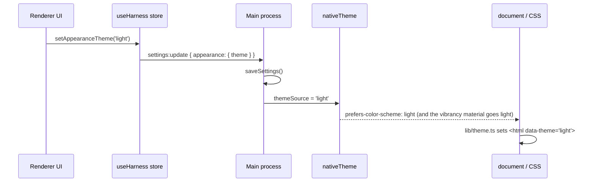

# Appearance: dark and light shells

Freyja has two shells. Dark is the original frosted-charcoal glass. Light is the same glass on warm paper: an off-white ground, warm ink, and definition from soft shadows instead of lines. `System` follows the macOS appearance, including its sunset schedule. This document describes how the switch works and where the colour system lives.

## What the operator sees

**Settings → appearance** (⌘,) shows three swatches: System, Dark, Light. Each swatch is a miniature of the window in that theme, so the choice is visible before it is made. The System swatch shows both halves and says which one macOS is asking for right now.

**⌘⇧L** flips between dark and light from anywhere. The sun or moon button in the sidebar footer, next to `settings`, does the same. The command palette (⌘K) has `Appearance: switch to … mode` and `Appearance: follow system`. A flip pins the opposite of what is on screen; Settings is where `system` comes back.

The choice is saved in `~/.freyja/settings.json` under `appearance.theme` and survives restarts.

## How the switch works

The main process owns the native side. `applyAppearance()` in `src/main/main.ts` mirrors the saved preference into `nativeTheme.themeSource` at window creation and after every settings write. That one assignment drives both the macOS vibrancy material behind the window and `prefers-color-scheme` inside it.

The renderer owns the painted side. `src/renderer/lib/theme.ts` reads `prefers-color-scheme` before the first React render (`initTheme()` in `main.tsx`) and writes the result to `<html data-theme>` and the CSS `color-scheme`. It listens for changes from then on. Because the media query inside Electron is a mirror of `themeSource`, the frost and the stylesheet can never disagree.

In a plain browser (design review, no preload) there is no main process. The preference then lives in `localStorage` under `freyja.appearance.theme` and is applied directly on top of the media query.

Canvas and WebGL painters cannot read CSS variables at draw time. They subscribe through `useEffectiveTheme()` (a tiny zustand store written by the same code path) and read concrete values with `cssTokenRgb()`. The topographic panel backdrops, the Morning Room wisp field, the kanban fabric, the task-form vector field and the voice sigil all do this.

Generative widgets run in sandboxed iframes with their own stylesheet (`src/renderer/widgetRuntime.ts`). The iframe is built with the current theme on `<html data-theme>` and receives a `ui/theme` message when the shell flips, so a mounted widget re-skins without reloading.

## The colour system

Everything resolves through CSS variables declared in `src/renderer/styles/globals.css`. `:root` holds the dark values; `:root[data-theme='light']` restates them. The variables are space-separated RGB triplets so both Tailwind classes (`bg-accent/10`) and hand-written CSS (`rgb(var(--ink) / 0.07)`) can attach an alpha.

The tokens are semantic, not literal:

| Token | Meaning | Dark | Light (paper) |
| --- | --- | --- | --- |
| `--ink` | text, hairlines, washes | white | warm near-black `#221e18` |
| `--paper` | the surface colour | near-black | warm off-white `#f8f5ef` |
| `--well`, `--well-k` | a recessed backing (code blocks, inputs, image wells) | black at the written alpha | warm brown, alpha scaled by 0.2 |
| `--shadow`, `--shadow-k` | drop and inset shadows | black | warm dark, alpha scaled by 0.5 |
| `--scrim` | the veil behind modals | black | warm dark grey |
| `--fg-0..4` | foreground scale, strongest first | light greys | warm greys, a step darker than the dark scale implies, because a label on paper carries its own contrast |
| `--bg-0..4` | surface scale, base first | charcoal | paper to pale sand |
| `--accent`, `-hi`, `-lo` | the one saturated hue | pale sky `#a8d4fc` | steel blue `#2864b4` |
| `--ok`, `--warn`, `--danger` | the muted status trio | greyed pastels | deepened to read on paper |
| `--chart-*`, `--tool-*`, `--file-*` | category hues for charts, tool bars, file types | pastel | deepened |
| `--card-shadow`, `--edge-shadow` | the two shadow recipes raised surfaces on paper are built from | unused | a whisper of edge, a contact shadow, a soft ambient fall-off |

Tailwind's `white` and `black` are remapped on purpose. The codebase writes `bg-white/5`, `border-white/10` and `text-white` to mean "ink on the surface", and `bg-black/30` to mean "a darker backing". Those are semantic uses, so `white` resolves to `--ink` and `black` to `--well`. A 30% black well that reads right on charcoal is a slab on white, which is why the well's alpha is scaled down in the light shell. `pure-white` and `pure-black` exist for the rare colour that must not flip.

The modal veil is a class, `scrim` (with `scrim-soft` and `scrim-strong`), because it needs a different alpha per theme: 0.62 on dark, 0.30 on light. A light veil over a light UI loses the figure/ground cue, so it stays dark in both.

### Surfaces

The glass rules are tuned for the frosted-dark vibrancy material: low-alpha charcoal fills and white hairlines. On the light material the same recipe is a muddy grey, so every surface is restated at the end of `globals.css` under `:root[data-theme='light']` on paper: a warm off-white fill at a noticeably higher alpha, a white top glint, and definition from layered soft shadows rather than lines. Dense lists on a light desktop need the opacity; the dark shell can afford 0.2 where the light shell uses 0.5 to 0.9. The window tint itself is strong (about 0.55) so the desktop becomes a soft wash and a thinking aside has a steady ground.

| Surface | Dark fill | Light fill |
| --- | --- | --- |
| `.app-tint` (the window) | near clear | paper 0.5–0.62 |
| `.glass` (structural panels) | charcoal 0.18–0.22 | paper 0.5–0.66 + card shadow |
| `.glass-panel` (sidebar, activity) | charcoal 0.32–0.36 | paper 0.6–0.76 |
| `.glass-strong` (dialogs) | charcoal 0.54 | paper 0.9 + deep shadow |
| `.menu-opaque`, `.modal-opaque` | charcoal 0.90–0.94 | paper 0.97–0.98 |
| `.glass-raised` (inline cards) | charcoal 0.30 | paper 0.62 + card shadow |
| `.cradle` (composer) | charcoal 0.46 | paper 0.82 |
| `.app-header` | charcoal 0.36–0.52 | paper 0.56–0.72 |
| `.find-bar` (⌘F) | charcoal 0.95 | paper 0.97 + lift |

Lines become edges: `.ring-hairline` is a half-pixel edge plus a contact shadow, and the same class on a card radius (`rounded-xl` and up) takes the full card shadow, so chips stay flat and cards lift. The common 1px utility hairlines (`border-white/[0.06]` and friends) are a notch softer. Full-window takeovers (the dashboard, artifacts, scheduler) get a faint paper grain and vignette through pseudo-elements, and the tasks tab's buckets become sheets (`.task-section`), with the agents dock (`.task-dock`) and a selected row (`.task-row-selected`) raised like keys; these classes are no-ops in the dark shell. The open task is a receipt in both shells (`TaskReceipt.tsx`, `.ticket-*`): a stub with a torn top edge, the mark, a running number, the status as a rubber stamp and the facts as dotted leaders, then a perforation with a notch at each end and the printed body with a torn bottom edge and a barcode from the task id. The edges are CSS masks (a conic-gradient sawtooth intersected with two radial notches), the shadow is a `drop-shadow` filter on the wrapper so it follows the torn silhouette, the stamp's ink is uneven through a luminance mask, and the body's edge fades ride a scroll-driven animation so a short ticket stays crisp. On paper the stock is whiter than the desk and the ink multiplies into the grain; in the dark shell the paper is a lifted grey with a hairline of light along its top edge. The title bar drops its band on paper: the strip is the window wash, keys (`.title-control-button`, `.title-chip`) are raised paper caps, the readouts sit in shallow wells, the strategy picker is a well holding one raised key, and a selected key is pressed into the desk. The activity tab's compressed-idle plates (`.receipt-idle`) keep their near-black plate in the dark shell and become paper tags with a sand edge on paper. The ⌘F find bar (`.find-bar`) is a paper slip lying over the transcript, and its matches (`.search-hit`) are highlighter on paper: a denser amber than the dark shell needs, with the ink staying ink.

## Adding colour to a component

- Use the Tailwind palette (`text-fg-1`, `bg-accent/10`, `bg-white/5`, `bg-black/30`). It is theme-aware by construction.
- Never set a background in an inline `style`. It beats both themes, so the element stays dark on paper (the ⌘F bar did until it got `.find-bar`). Give the element a class and restate it in the light block.
- In CSS, write `rgb(var(--ink) / 0.07)` rather than `rgba(255,255,255,0.07)`, and `rgb(var(--well) / calc(0.3 * var(--well-k)))` for a backing.
- For a category hue, add a `--chart-*` / `--tool-*` / `--file-*` style token in both blocks of `globals.css` and reference `var(--name)`. SVG presentation attributes (`fill`, `stroke`, `stop-color`) accept `var()`.
- To attach an alpha to a token that is already a colour, use `color-mix(in srgb, var(--x) 33%, transparent)`. Hex suffixes (`${color}55`) no longer work because the value is a `var()`.
- Raster painters read `cssTokenRgb('--accent-rgb', fallback)` inside the draw path and re-run it when `useEffectiveTheme()` changes.

Widgets have their own runtime inside a sandboxed frame and their own document, [WIDGETS.md](WIDGETS.md); the frame element's `color-scheme` must match the shell or Chromium paints it opaque.

## Checking it

`test-theme.mjs` at the repo root exercises the resolution, the toggle, the document attribute and the browser-mode persistence under jsdom. Run it from the repo root with `npx tsx test-theme.mjs` (or `node --experimental-strip-types test-theme.mjs`) after `npm i --no-save jsdom`.

For a visual check in the running app with real vibrancy, open its inspector with `kill -USR1 <main pid>` (the inspect fuse is on), then insert a candidate stylesheet with `webContents.insertCSS` through `scripts/perf/mainrpc.mjs`, open views through `window.__harnessStore.getState()`, and capture the window with `screencapture -l<id>` using the id from `BrowserWindow.getMediaSourceId()`. The paper design was tuned that way.

For a visual check without the app, build the renderer unminified (`npx vite build --outDir <dir> --minify false`), serve it with `scripts/perf/mock-harness.js` and Playwright, open `/?backdrop=1`, and capture with the browser context's `colorScheme` set to `dark` and `light`. The `?backdrop=1` flag paints a simulated desktop under each glass: a night sky for dark, a hazy daylight for light.
