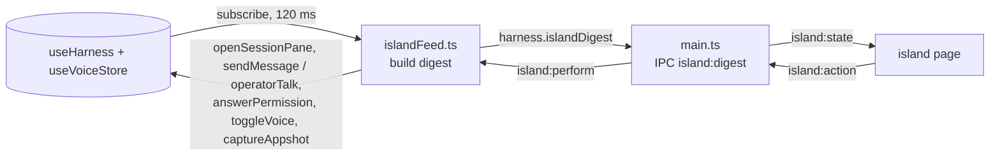

# The island

A small always-on-top window fused with the notch of the built-in display (or hanging from the top edge of a display without one). It shows what Freyja is doing while you are in another app, and lets you act without switching: allow or deny a tool, reply to a session, start a voice conversation, open the board. Code: `src/main/island.ts` (the window), `src/preload/island-preload.ts` (its bridge), `src/renderer/island/` (the page), `src/renderer/lib/islandFeed.ts` (the feed), `src/shared/island.ts` (the shapes).

## What it shows

The strip is the part fused with the notch: two ears either side of the hardware, snug against it, as on the phone. The sheet drops below the strip when the island opens.

| State | Leading ear | Trailing ear |
| --- | --- | --- |
| quiet | the mark | the count of open tasks, if any |
| live (one turn) | the mark, breathing | the tool in flight and its argument, or "thinking" or "writing", and the turn's elapsed time |
| live (several) | the mark, breathing | "3 live" and the oldest turn's elapsed time |
| needs you | the mark | a NEEDS YOU tag and the prompt; the whole shape gets an amber hairline |
| voice | the voice sigil | the state or the line being said, and a three-bar mic meter |
| just finished | the mark | a check that draws itself |

A finished turn hangs a banner from the notch for eight seconds: the session's title, how long the turn took, the first lines of the reply. Click it to open the session.

The sheet, from top to bottom:

- **Cards for what needs you.** A permission prompt with deny and allow (allow turns red for a dangerous level), an MCP question with decline and "answer in Freyja", a voice action waiting for a yes.
- **Live.** One row per turn in flight or helper at work: title, current tool, elapsed time, and the tail of the reply as it is written. Click to open it.
- **Just finished.** The last turn that ended, with its opening lines.
- **Tasks.** The board's four counts and the four most recently touched tasks. A task that just closed gets the receipt's DONE stamp slammed on it.
- **Reply.** A composer aimed at the active session, with a picker for the other recent ones. Enter queues after the turn, ⌘↵ cuts in. Sending folds the island and hands the keyboard back.
- **Keys.** Talk (start or end a voice conversation, with the real hotkey), capture (an appshot into the composer), board, open Freyja.

## Where it lives

Main picks the built-in display when there is one, else the primary. The window is a 760×480 transparent, frameless, non-activating panel at screen-saver level, so it draws over the menu bar, the notch and full-screen apps, and typing into it never brings Freyja forward. It is shown inactive and ignores the mouse until the page reports the pointer is over the drawn island; everything outside the island is click-through. The island itself paints at the top centre of the window, which is the centre of the display, which is the centre of the notch.

A notched display is recognised by a menu bar at least 30 points tall on the internal display; the notch is 185 points wide on every notched MacBook so far (measured here with AppKit's auxiliary top areas on a 16-inch: 185 wide, 32 tall, menu bar 33). `settings.island.notchWidth` overrides it. The strip takes the menu bar's height so it reads as the notch, grown. On a display without a notch the strip is 26 points or the menu bar's height, whichever is taller.

Both shells: on a notched display the strip is hardware black in both themes, because it is the notch, and only the sheet follows the theme (dark glass, or paper under a black cap). On a display without a notch the whole island follows the theme: an obsidian pebble, or an ivory one with ink.

## How it is wired

Main holds no session state, so the main renderer reduces its store into an `IslandDigest` (live turns, attention, the last finished turn, voice, tasks, recent sessions, today's spend) after every batched store change, and pushes it only when it differs from the last one. The island never sees the event stream and never calls `getMode`, which is the main window's "renderer ready" switch. Actions come back through main: raising the app is main's job, everything else is performed by the main renderer against its store.

The window itself talks to main on `island:control`: `ready` (send me the geometry and the state), `hover` (toggle click-through), `release` (give the keyboard back).

`settings.island.enabled` (default on) opens or closes the window; the switch is in Settings → island. ⌃⌥⌘I (or ⌃⌥⇧I when taken; `FREYJA_ISLAND_HOTKEY` overrides) opens the island if it is closed and otherwise expands or collapses it. Esc folds it.

## Motion

The shape morphs with a spring (`linear()` easing) on width and height; `interpolate-size: allow-keywords` lets the height run to `auto`. Content that changes in the ears slides up through a blur. The sheet drops in. The check in the ear draws itself. The stamp on a closed task lands from above. Reduced motion turns all of it off.

## Checking it

- `island-shots.mjs` (scratch) serves a Vite build and renders `island.html` in headless Chrome with fixture digests in both themes over a fake menu bar, including the expanded, hovered, stamped and no-notch states. The page runs a stand-in bridge when `window.island` is missing: `window.__islandPush(digest)`, `window.__islandGeometry(g)`, `window.__islandToggle()`, and it records actions on `window.__islandActions`.
- The Electron harness (scratch `harness-entry.ts`, bundled with esbuild) opens the real window with the built page, cycles the fixtures, and captures the page. The window reported bounds at y = 0 on the built-in display, so macOS does not push it under the menu bar.
- The notch: `swiftc` a four-line AppKit script that prints each screen's `auxiliaryTopLeftArea` and `safeAreaInsets`.

Known limits: computer-use screen captures include the island (appshots skip it, since they skip Freyja's own windows); export dialogs attach to the focused window, so one opened while the island has the keyboard attaches there; the hit count for "live" comes from the slices the renderer has loaded, so sessions never opened this launch are not counted until they are.
