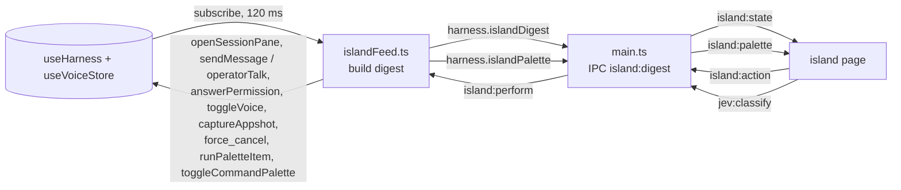

# The island

A small always-on-top pane hanging from the notch of the built-in display (or from the top edge of a display without one). It is pitch black in both shells, the notch's own black, so the strip reads as the notch grown ears and the open sheet as the notch poured open. It shows what Freyja is doing while you are in another app, and it is ⌘K in the notch: one field replies to a session, searches the palette's rows, or asks Jev what a sentence means, without switching apps. Code: `src/main/island.ts` (the window), `src/preload/island-preload.ts` (its bridge), `src/renderer/island/` (the page: `Island.tsx` the shape and the strip, `Sheet.tsx` the sheet, `Intent.tsx` the Jev card), `src/renderer/lib/islandFeed.ts` (the feed), `src/renderer/lib/paletteItems.ts` (the palette's rows, shared with ⌘K), `src/shared/island.ts` (the shapes), `src/renderer/styles/island.css`.

## The strip

The strip is the part at the notch: two ears either side of the hardware, snug against it, as on the phone. Each ear has a fixed width per mode, so the shape never moves while the words inside it change; a detail that is longer than its box runs as tape, newest characters at the right and the start fading out. The width changes only when the mode changes, with a spring.

| State | Leading ear | Trailing ear |
| --- | --- | --- |
| quiet | the mark | the count of open tasks, if any |
| live, one turn | the mark, breathing, and the session's title | what it is doing (thinking, writing, or the tool), the tool's argument or the tail of the reply as tape, and the turn's elapsed time |
| live, several | the mark and "N live" | what most of them are doing ("7 writing") and the oldest turn's elapsed time |
| live, following one | the mark, that session's title and "+N" for the others | that session's word, tape and clock |
| needs you | the mark and a NEEDS YOU tag; the whole pane gets an amber hairline | the prompt as tape, "+N" when more wait |
| voice | the voice sigil and the state | the line being heard or said as tape, and a three-bar mic meter |
| just finished | the mark blooming out of nothing | a check that draws itself, "done" and the turn's duration |

A finished turn hangs a banner from the notch for eight seconds: the session's title, the first lines of the reply, and a reply key that opens the sheet with the field aimed at that session. Click the banner to open the session. Hovering the strip opens the sheet; clicking an open strip folds it. The island is a shelf: drop an image or a video on it and it lands in the composer's tray in Freyja (other files are refused with a toast), drop text and it lands in the field with the caret ready.

## The sheet

The sheet drops below the strip. The field sits at the top, pinned; the foot (talk, capture, board, open Freyja, today's spend, the next scheduled job and the key legend) is pinned at the bottom; everything between scrolls, with a fade at whichever edge has more.

**The field is one box with three outcomes.** Empty, the sheet shows what is happening now. Typed, the rows that match replace it: a command, a session, a helper or a skill whose title or description contains the text, grouped as ⌘K groups them, with "send to <session>" as a row of its own. A title that starts with the text is what you are reaching for, so that row is selected and ↵ runs it; otherwise ↵ sends the text to the session the field is aimed at, queued after its turn, and ⌘↵ cuts in. The select beside the field picks the session (the active one first, then the recent ones); a row's reply key and the banner's reply key aim it too.

**A sentence becomes a card.** Three characters in, with no row reached for, the sentence goes to Jev, the same classifier ⌘K uses (`jev:classify`), and the slots are parsed from the words on every keystroke (`paletteIntent.ts`). The card names the domain, fills its slots as the sentence grows ("what did nari say" → who; "… about lisbon" → about; "… last week" → when), shows the required slots as a progress bar and the other domains Jev considered as chips that pin a different reading. The card already showing stays while the sentence grows, as in ⌘K. What ↵ does depends on the card: recall, delegate and spend compose the same instruction the ⌘K card would and send it to the aimed session; voice, appearance, the Morning Room and the swarm act directly; calendar, pull requests, Slack, artifacts, the model picker, usage, diagnostics, tools, skills and the context budget open ⌘K in Freyja with the sentence typed, because their cards need the app's data. Every card has an "in Freyja" key for that. The field's hint always says what ↵ will do.

**What is happening now**, when the field is empty, top to bottom:

- **Cards for what needs you.** A permission prompt with deny and allow (allow turns red for a dangerous level), an MCP question with decline and "answer in Freyja", a voice action waiting for a yes. A new one nudges the shape and opens the sheet for six seconds.
- **Live.** One row per turn in flight or helper at work: title, what it is doing, elapsed time. Helpers sit under their parent; a parent that is not itself live becomes a group row with the count, a fold toggle and a stop key for all of its helpers. With more than one live, the header has "stop all". Click a row (or press → on it) to open it: the tail of the reply, the tool's full argument, and keys to reply (aims the field), follow (the strip shows this session), stop, and open in Freyja. Double-click opens it in Freyja.
- **Just finished.** The last turn that ended, with its opening lines.
- **Tasks.** The board's four counts and the four most recently touched tasks, when there are any. A task that just closed gets the receipt's DONE stamp slammed on it.
- **Recent.** When nothing is live, the recent sessions, so the island is a launcher.

**Keyboard.** ⌃⌥⌘I (or ⌃⌥⇧I when taken; `FREYJA_ISLAND_HOTKEY` overrides) opens the island if it is closed and otherwise expands or collapses it; when it opens the sheet, the island asks main for the keyboard (`focus`, which makes the panel the key window without activating the app) and puts the caret in the field. ↑↓ move through the rows (⌘↑ ⌘↓ to the ends, ⇞ ⇟ by pages); ↵ acts on the selected row (runs a match, sends the text, opens a live row's detail, opens a session) and ⌘↵ does it in Freyja (or cuts a reply in); → and ← open and close a live row's detail; Esc clears the field, and a second Esc folds the island and hands the keyboard back (`release`). So does the keyboard leaving on its own. A folded island goes back to click-through; an open one keeps the mouse so a key can be clicked without a prior hover. The foot prints the hotkey and the keys.

## Where it lives

Main picks the built-in display when there is one, else the primary. The window is a 760×600 transparent, frameless, non-activating panel at screen-saver level, so it draws over the menu bar, the notch and full-screen apps, and typing into it never brings Freyja forward. It is shown inactive and ignores the mouse until the page reports the pointer is over the drawn island; everything outside the island is click-through. The island itself paints at the top centre of the window, which is the centre of the display, which is the centre of the notch, and never grows taller than the window less a margin: the sheet's scroller takes the difference.

A notched display is recognised by a menu bar at least 30 points tall on the internal display; the notch is 185 points wide on every notched MacBook so far (measured here with AppKit's auxiliary top areas on a 16-inch: 185 wide, 32 tall, menu bar 33). `settings.island.notchWidth` overrides it. The strip takes the menu bar's height so it reads as the notch, grown. On a display without a notch the strip is 26 points or the menu bar's height, whichever is taller, and the island is a black pebble hanging from the top edge.

## The black

The pane is `#000` in both shells, whatever the app's appearance: the page pins the dark tokens and never follows the media query, and `island.css` carries its own colours (white type at 0.92 and 0.55, the accent, muted ok/warn/danger). Depth comes from three things: the shadow the pane throws on the screen below, a half-pixel hairline of light along the rim so the pane still reads over a dark window, and surfaces inside that are a shade lighter than the pane (rows under the pointer, cards, the field, the keys as capsules lit along their top edge). At the top outer corners the black flares into the screen edge with small concave fillets, the way a drop hangs from a ceiling, so the pane reads as poured from the notch rather than stuck under it. Type is the system sans at 12 to 13 px, with the mono face for clocks, figures and the readout.

Earlier versions were a pane of glass (a native masked blur, then macOS 26 Liquid Glass behind the window, through an N-API shim); the black replaced them at the user's call, and the shim went with them (git history before `69c27c8` has it).

## How it is wired

Main holds no session state, so the main renderer reduces its store into an `IslandDigest` (live turns with their parent, attention, the last finished turn, voice, tasks, recent sessions, today's spend) after every batched store change, and pushes it only when it differs from the last one. The island never sees the event stream and never calls `getMode`, which is the main window's "renderer ready" switch. Actions come back through main: raising the app is main's job, everything else is performed by the main renderer against its store. Stopping goes to the bridge as `force_cancel` (the active session's turn through the store, so its spinners stop too). When the sheet opens the island asks for the palette's rows (`palette-index`), the feed answers with titles only (every command and skill, the helpers, and the eighty most recent sessions) and runs a chosen row by id (`palette-run`) through the same builder ⌘K uses; `palette-open` opens ⌘K in Freyja with the sentence typed. Jev is asked by the island's own bridge, straight to main.

The window itself talks to main on `island:control`: `ready` (send me the geometry and the state), `hover` (toggle click-through), `focus` and `release` (take the keyboard, give it back).

`settings.island.enabled` (default on) opens or closes the window; the switch is in Settings → island, and ⌘K has "Island: hide" and "Island: show". While computer use is capturing the screen the digest says so and main hides the island, so it is never in a shot; it comes back inactive after.

## Motion

The shape morphs with a spring (`linear()` easing) on width and height; `interpolate-size: allow-keywords` lets the height run to `auto`. Content that changes in the ears slides up through a blur; the tape just changes, no motion. The sheet drops in, a row's detail unfolds, the check in the ear draws itself, the stamp on a closed task lands from above. Reduced motion turns all of it off.

## Checking it

- `island-probe/shots2.mjs` (scratch) serves a Vite build and renders `island.html` in headless Chrome with fixture digests, a palette index and a stand-in for Jev (`window.__islandJev`), over a fake menu bar and app in light and dark, and checks the behaviour: the strip's width while the peek grows, ten live rows scrolling inside a sheet that fits the window, a row's stop and follow, the hotkey's caret, ↓ ↵ ⌘↵ on rows, a title prefix running its row, a reply cutting in, a sentence becoming a card with slots that fill in, the two Escapes. The page runs a stand-in bridge when `window.island` is missing: `window.__islandPush(digest)`, `window.__islandGeometry(g)`, `window.__islandPalette(index)`, `window.__islandToggle()`, and it records actions on `window.__islandActions`.
- The Electron harness (scratch) opens the real `IslandWindow` with the built page, parked at the top-left of the screen (`X=-80`, over the menu bar's text) for a few seconds, and captures it with `screencapture -R` from the shell (it fails inside Electron). At screen-saver level it is visible on every space, so keep each run short and close it after.
- The notch: `swiftc` a four-line AppKit script that prints each screen's `auxiliaryTopLeftArea` and `safeAreaInsets`.

Known limits: computer-use screen captures include the island (appshots skip it, since they skip Freyja's own windows); export dialogs attach to the focused window, so one opened while the island has the keyboard attaches there; the hit count for "live" comes from the slices the renderer has loaded, so sessions never opened this launch are not counted until they are; stopping one helper by its row sends `force_cancel` for that helper's session, which the bridge honours only for helpers that have a session of their own.
