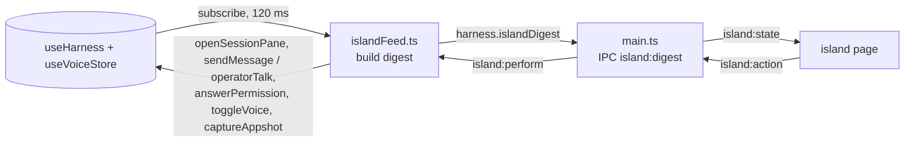

# The island

A small always-on-top pane of glass hanging from the notch of the built-in display (or from the top edge of a display without one). It shows what Freyja is doing while you are in another app, and lets you act without switching: allow or deny a tool, reply to a session, start a voice conversation, open the board. Code: `src/main/island.ts` (the window), `src/main/glass.ts` + `native/island-glass/` (the backdrop blur), `src/preload/island-preload.ts` (its bridge), `src/renderer/island/` (the page), `src/renderer/lib/islandFeed.ts` (the feed), `src/shared/island.ts` (the shapes).

## What it shows

The strip is the part at the notch: two ears either side of the hardware, snug against it, as on the phone, with the glass running behind the notch the way the menu bar's material does. The sheet drops below the strip when the island opens.

| State | Leading ear | Trailing ear |
| --- | --- | --- |
| quiet | the mark | the count of open tasks, if any |
| live (one turn) | the mark, breathing | the tool in flight and its argument, or "thinking" or "writing", and the turn's elapsed time |
| live (several) | the mark, breathing | "3 live" and the oldest turn's elapsed time |
| needs you | the mark | a NEEDS YOU tag and the prompt; the whole shape gets an amber hairline |
| voice | the voice sigil | the state or the line being said, and a three-bar mic meter |
| just finished | the mark | a check that draws itself |

A finished turn hangs a banner from the notch for eight seconds: the session's title, how long the turn took, the first lines of the reply, and a reply key that opens the sheet with the composer aimed at that session. The mark in the leading ear blooms out of nothing as the banner lands. Click the banner to open the session.

The sheet, from top to bottom:

- **Cards for what needs you.** A permission prompt with deny and allow (allow turns red for a dangerous level), an MCP question with decline and "answer in Freyja", a voice action waiting for a yes.
- **Live.** One row per turn in flight or helper at work: title, current tool, elapsed time, and the tail of the reply as it is written. Click to open it.
- **Just finished.** The last turn that ended, with its opening lines.
- **Tasks.** The board's four counts and the four most recently touched tasks. A task that just closed gets the receipt's DONE stamp slammed on it.
- **Reply.** A composer aimed at the active session, with a picker for the other recent ones. Enter queues after the turn, ⌘↵ cuts in. Sending folds the island and hands the keyboard back.
- **Keys.** Talk (start or end a voice conversation, with the real hotkey), capture (an appshot into the composer), board, open Freyja.
- **Readout.** Today's spend across the sessions touched today, and the next scheduled job with its time.

While a reply is being written with no tool in flight, the trailing ear shows the tail of the reply as it grows: the sneak peek. A new needs-you item nudges the shape once and opens the sheet for six seconds, so allow or deny is one click away; it stays open while the pointer is on it or the caret is in the reply.

The island is a shelf: drop an image or a video on it and it lands in the composer's tray in Freyja (other files are refused with a toast), drop text and it lands in the island's own reply box with the caret ready. The strip shows DROP · to attach while something is over it.

## Where it lives

Main picks the built-in display when there is one, else the primary. The window is a 760×480 transparent, frameless, non-activating panel at screen-saver level, so it draws over the menu bar, the notch and full-screen apps, and typing into it never brings Freyja forward. It is shown inactive and ignores the mouse until the page reports the pointer is over the drawn island; everything outside the island is click-through. The island itself paints at the top centre of the window, which is the centre of the display, which is the centre of the notch.

A notched display is recognised by a menu bar at least 30 points tall on the internal display; the notch is 185 points wide on every notched MacBook so far (measured here with AppKit's auxiliary top areas on a 16-inch: 185 wide, 32 tall, menu bar 33). `settings.island.notchWidth` overrides it. The strip takes the menu bar's height so it reads as the notch, grown. On a display without a notch the strip is 26 points or the menu bar's height, whichever is taller.

## Glass

The island is frosted glass in both shells: smoked glass with light type in the dark shell, frosted white with ink on paper. Type is the system sans at 12 to 13 px, with the mono face kept for clocks and figures. A glass pane needs a real blur of what is behind the window, and Electron's own vibrancy frosts the whole window rectangle, so a small native shim does it in the island's shape: `native/island-glass/glass.m` puts an `NSVisualEffectView` behind the page (`underWindowBackground` on dark, `popover` on light, with the appearance forced to match the page's theme) and masks it with a 9-slice image whose bottom corners carry the island's radius. The page sends the drawn island's rect and radii on `island:control` as `shape` whenever they change, every frame while the shape is in motion, and its theme as `theme`, so the frosted area is exactly the island and nothing else. `island.css` adds the tint, a sheen along the top edge, a rim of light, an ink hairline and the shadow on top, and the keys, inputs and cards are chips of thicker glass.

The shim is an N-API module built by `scripts/build-glass.sh` (part of `npm run build` and of `npm run dev`) with clang and the Node headers that ship with every Node install; it is ABI-stable across Electron versions. It is best effort: when it does not build, main logs why, `IslandGeometry.glass` is false, and the page sets `data-glass="css"` on its root, which makes the tint nearly solid so the words keep a ground.

## How it is wired

Main holds no session state, so the main renderer reduces its store into an `IslandDigest` (live turns, attention, the last finished turn, voice, tasks, recent sessions, today's spend) after every batched store change, and pushes it only when it differs from the last one. The island never sees the event stream and never calls `getMode`, which is the main window's "renderer ready" switch. Actions come back through main: raising the app is main's job, everything else is performed by the main renderer against its store.

The window itself talks to main on `island:control`: `ready` (send me the geometry and the state), `hover` (toggle click-through), `focus` and `release` (take the keyboard, give it back), `shape` and `theme` (where the glass goes and which material it is).

`settings.island.enabled` (default on) opens or closes the window; the switch is in Settings → island, and ⌘K has "Island: hide" and "Island: show". While computer use is capturing the screen the digest says so and main hides the island, so it is never in a shot; it comes back inactive after. ⌃⌥⌘I (or ⌃⌥⇧I when taken; `FREYJA_ISLAND_HOTKEY` overrides) opens the island if it is closed and otherwise expands or collapses it. When the hotkey opens the sheet, the island asks main for the keyboard (`focus`, which makes the panel the key window without activating the app) and puts the caret in the reply. Esc folds it and hands the keyboard back (`release`); so does the keyboard leaving on its own. A folded island goes back to click-through; an open one keeps the mouse so a key can be clicked without a prior hover.

## Motion

The shape morphs with a spring (`linear()` easing) on width and height; `interpolate-size: allow-keywords` lets the height run to `auto`. Content that changes in the ears slides up through a blur. The sheet drops in. The check in the ear draws itself. The stamp on a closed task lands from above. Reduced motion turns all of it off.

## Checking it

- `island-shots.mjs` (scratch) serves a Vite build and renders `island.html` in headless Chrome with fixture digests in both themes over a fake menu bar, including the expanded, hovered, stamped and no-notch states. The page runs a stand-in bridge when `window.island` is missing: `window.__islandPush(digest)`, `window.__islandGeometry(g)`, `window.__islandToggle()`, and it records actions on `window.__islandActions`.
- The Electron harness (scratch `harness-entry.ts`, bundled with esbuild) opens the real window with the built page, cycles the fixtures, and captures the page. The window reported bounds at y = 0 on the built-in display, so macOS does not push it under the menu bar.
- The notch: `swiftc` a four-line AppKit script that prints each screen's `auxiliaryTopLeftArea` and `safeAreaInsets`.
- The glass: a second harness (scratch `harness2.ts`, bundled the same way) opens the real `IslandWindow` with the shim and a small HTTP port on 127.0.0.1:47631 that takes `{fixture, theme, expanded, css, js, describe, controls, quit}`; a `ctl.mjs` posts a command, waits, and runs `screencapture -R` from the shell (it fails inside Electron). Park the window at the top-left (`X=-80`) so it sits over the menu bar's text and away from the live island, keep each run short, and close it after: at screen-saver level it is visible on every space. `describe` prints the content view and the glass frame, `controls` the last shape messages, so the mask can be checked against the page. Captures taken mid-spring showed no gap between the pane and its blur.

Known limits: the blur needs the shim, so a machine without clang or the Node headers gets the CSS pane; computer-use screen captures include the island (appshots skip it, since they skip Freyja's own windows); export dialogs attach to the focused window, so one opened while the island has the keyboard attaches there; the hit count for "live" comes from the slices the renderer has loaded, so sessions never opened this launch are not counted until they are.
