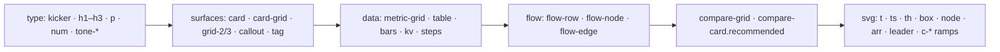

# Generative widgets

A widget is an HTML or SVG fragment the model writes with `show_widget`. The renderer mounts it in a sandboxed iframe inside the transcript with a pre-loaded runtime: tokens, classes, the Tabler icon font, two JS globals and the elicitation form chrome. `src/renderer/widgetRuntime.ts` builds the iframe document; `src/renderer/components/Widget.tsx` hosts it; `bridge/tools/widget_tool.py` holds the spec the model reads through `widget_spec` and the `show_widget` tool.

## What the runtime guarantees

The widget floats on the transcript. There is no background in either shell: the root sits flush left like a paragraph, at most 760px wide, and SVG keeps a 680px design width. The frame element and the embedded document must agree on `color-scheme`; when they disagree Chromium paints the frame opaque, which was the white slab under the light shell.

Type is the shell's own. Geist Mono carries labels, figures and prose at 12.5px, and `h1` to `h3` switch to Fraunces. Both load from jsdelivr, because the sandboxed frame has an opaque origin and cannot read the app's bundled fonts; the stacks fall back to `ui-monospace` and Georgia offline.

Surfaces are washes and hairlines, not boxes. `--wash` is a breath of ink on paper or of light on the dark material, `--hair` is a half-pixel edge, and the tone variants (`info`, `success`, `warning`, `danger`) tint the wash and the edge together.

Model markup is written blind, so the stylesheet keeps it inside the frame: grid and flex children may shrink (`min-width: 0`), long words break, media and tables never exceed the root, SVG keeps its aspect ratio, `white-space: nowrap` is undone, `position: fixed` becomes relative, and preformatted text wraps. After mount, and again when the webfonts land, the runtime measures every SVG `<text>` that starts inside a `<rect>` drawn before it and, when the run overruns the box, shrinks the type a little and squeezes the glyphs the rest of the way. The frame reports its height on every resize and once more after late fonts, icons and CDN scripts.

## Classes

`.flow` is the answer to flowcharts. Nodes size to their words and wrap, the runtime draws the arrows between nodes in a row, and a `.flow-edge` between rows carries the transition and its label. SVG remains for geometry: scatters, maps, nested shapes.

## What the model is told

The spec in `widget_tool.py` states the constraints the runtime cannot enforce. The ones that matter most:

- No fixed pixel widths or heights on anything that holds text, and no `nowrap`.
- Flowcharts are HTML (`.flow`), not SVG.
- SVG text is monospace and cannot wrap: a box must be at least `characters × 0.6 × font-size + 24` wide, labels stay under 20 characters, and edge labels sit in the gap between boxes.
- Tables are plain `<table>` markup with a `<thead>`; numeric columns take `class="num"`.
- Grids are the runtime's auto-fit grids, never hand-written pixel columns.
- One idea per widget, under about 2,000 characters, and prose when a widget adds nothing.

## Checking a change

Real fragments are the fixture set: any dict with a `widget_code` key inside `~/.freyja/sessions/*.json` is one. Bundle the runtime with esbuild (`esbuild src/renderer/widgetRuntime.ts --bundle --format=esm`), build each fragment with `buildWidgetHtml` for both themes, mount them as `sandbox="allow-scripts"` iframes on a paper and a dark ground with a host that applies `ui/resize`, and screenshot each one after scrolling it into view. Offscreen sandboxed frames are not painted until they are on screen, so a full-page screenshot shows them blank. Keep the fixtures out of the repo; they contain session content.
